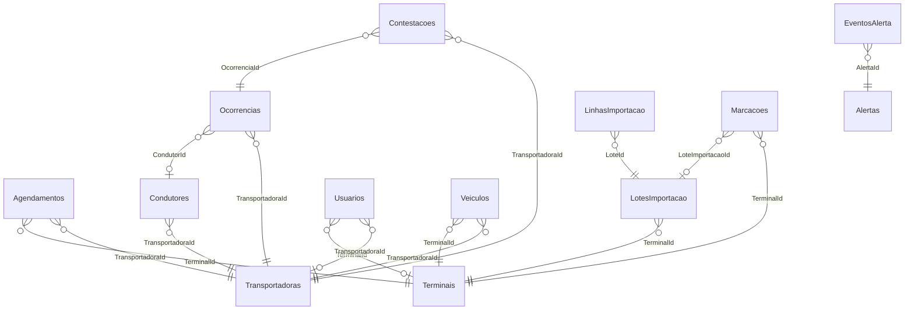

# Relacionamentos

> Arquivo **gerado** por `dotnet run --project backend/src/BarcaLog.Api -- dicionario` a partir do código
> (modelo do EF Core, enums, ApiExplorer e comentários XML) e de `docs/dicionario-de-dados/curadoria.json`.
> Não edite à mão: o CI recusa o arquivo se ele divergir do código.

Relacionamentos **explícitos** (chaves estrangeiras no banco). Associações indiretas, sem FK, estão em `../modelo-relacional.md`.

| Origem (N) | Campo(s) | Destino (1) | Cardinalidade | Obrigatório | Ao excluir o destino |
|---|---|---|---|---|---|
| Agendamentos | TerminalId | Terminais.Id | N:1 | sim | NO ACTION (impede excluir com vínculos) |
| Agendamentos | TransportadoraId | Transportadoras.Id | N:1 | sim | NO ACTION (impede excluir com vínculos) |
| Condutores | TransportadoraId | Transportadoras.Id | N:1 | sim | NO ACTION (impede excluir com vínculos) |
| Contestacoes | OcorrenciaId | Ocorrencias.Id | N:1 | sim | NO ACTION (impede excluir com vínculos) |
| Contestacoes | TransportadoraId | Transportadoras.Id | N:1 | sim | NO ACTION (impede excluir com vínculos) |
| EventosAlerta | AlertaId | Alertas.Id | N:1 | sim | CASCADE |
| LinhasImportacao | LoteId | LotesImportacao.Id | N:1 | sim | CASCADE |
| LotesImportacao | TerminalId | Terminais.Id | N:1 | sim | NO ACTION (impede excluir com vínculos) |
| Marcacoes | LoteImportacaoId | LotesImportacao.Id | N:1 | não | NO ACTION (impede excluir com vínculos) |
| Marcacoes | TerminalId | Terminais.Id | N:1 | sim | NO ACTION (impede excluir com vínculos) |
| Ocorrencias | CondutorId | Condutores.Id | N:1 | não | SET NULL |
| Ocorrencias | TransportadoraId | Transportadoras.Id | N:1 | sim | NO ACTION (impede excluir com vínculos) |
| Usuarios | TerminalId | Terminais.Id | N:1 | não | NO ACTION (impede excluir com vínculos) |
| Usuarios | TransportadoraId | Transportadoras.Id | N:1 | não | NO ACTION (impede excluir com vínculos) |
| Veiculos | TerminalId | Terminais.Id | N:1 | sim | NO ACTION (impede excluir com vínculos) |
| Veiculos | TransportadoraId | Transportadoras.Id | N:1 | sim | NO ACTION (impede excluir com vínculos) |
