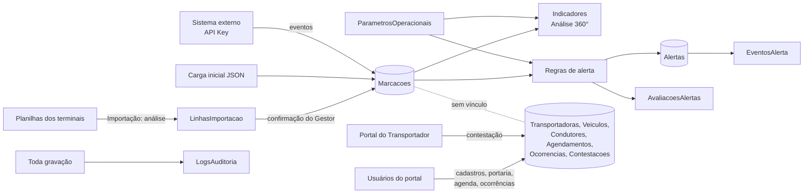

# Modelo relacional — visão geral e associações indiretas

Chaves estrangeiras, cardinalidade e regra de exclusão: `gerado/relacionamentos.md` (gerado).
Este arquivo explica o modelo e registra o que **não** está protegido por chave estrangeira.

## Objetivo do modelo

Registrar o fluxo de carretas nos terminais (marcação → liberação) a partir das fontes
disponíveis, medir espera e volume, gerar e tratar alertas, e manter os cadastros e a disciplina
(N1/N2/N3) usados pela portaria, pela agenda e pelo Portal do Transportador — com auditoria de
toda alteração.

## Grupos de tabelas

| Grupo | Tabelas | Dados hoje |
|---|---|---|
| Operação observada | `Marcacoes`, `Terminais`, `Convenios` | Reais (planilhas e carga inicial) |
| Importação | `LotesImportacao`, `LinhasImportacao` | Reais |
| Alertas | `Alertas`, `EventosAlerta`, `AvaliacoesAlertas`, `ParametrosOperacionais` | Reais (calculados) |
| Cadastros e disciplina | `Transportadoras`, `Veiculos`, `Condutores`, `Ocorrencias`, `Contestacoes`, `Agendamentos` | **Demonstração** (fictícios) |
| Acesso e controle | `Usuarios`, `LogsAuditoria`, `ChavesIdempotencia` | Reais |

## Fluxo dos dados

O ponto mais importante para quem integra: **as marcações (dado real) não têm ligação com os
cadastros (veículo, transportadora, motorista)**. As planilhas dos terminais não trazem placa,
transportadora nem motorista, então não há como saber qual carreta cadastrada corresponde a qual
movimento. Por isso Portaria, Agenda e Negativação ainda operam sobre dados de demonstração.

## Associações sem chave estrangeira

Relações que existem na regra de negócio ou na tela, mas **não** são garantidas pelo banco.

| Origem | Destino | Como se relacionam | Risco | Observação |
|---|---|---|---|---|
| `Marcacoes.CodConvenio` | `Convenios.Codigo` | Mesmo código | Código na marcação sem cadastro | Carga inicial não tem código; convênio é criado na confirmação da importação |
| `Marcacoes.Operador`, `Marcacoes.Carga` | `Convenios.Operador`, `Convenios.Carga` | **Cópia** feita na importação | Corrigir o convênio não altera marcações já gravadas | Decisão registrada; reclassificação pendente (decisoes-e-pendencias.md) |
| `Ocorrencias.Placa` | `Veiculos.Placa` | Placa normalizada | Ocorrência com placa sem veículo cadastrado é aceita | **N3 numa placa não cadastrada não bloqueia nada**: não há veículo a negativar, e a mesma placa continua podendo ser agendada |
| `Agendamentos.Placa` | `Veiculos.Placa` | Placa normalizada | Placa não cadastrada é aceita | Placa cadastrada precisa ser da mesma transportadora e não estar negativada |
| `Condutores.PlacaVinculada` | `Veiculos.Placa` | Texto | Placa inexistente | Informativo |
| `Agendamentos.Motorista` | `Condutores` | Texto livre | Nome que não corresponde a condutor | Não há vínculo por id |
| `Alertas.TerminalId` | `Terminais.Id` | Mesmo slug | Terminal removido | Nulo = alerta geral |
| `Usuarios.TerminalPreferido` | `Terminais.Id` | Mesmo slug, validado pela API | Terminal removido | Preferência; o vínculo (`TerminalId`) tem FK |
| `LinhasImportacao.MovimentoId` | `Marcacoes.MovimentoId` | Mesmo id | — | Área de revisão; a linha pode não existir em Marcacoes (nova ou rejeitada) |
| `LogsAuditoria.Autor`, `Alertas.Responsavel`, `EventosAlerta.Autor`, `LotesImportacao.CriadoPor` | `Usuarios` | Texto "Nome <e-mail>" | Usuário renomeado ou anonimizado não muda o histórico | Intencional: auditoria guarda quem era no momento |
| `Veiculos.TerminalId` | `Terminais.Id` | FK | — | Significado (terminal "da" carreta) a validar: a mesma carreta pode atender mais de um terminal |

## Inconsistências entre modelo e regras de negócio (a decidir)

1. Marcações e cadastros não se ligam (ver acima). Solução depende de a fonte passar a trazer a
   placa ou de os checkpoints serem registrados pelo BarcaLog.
2. `Veiculos.StatusPortaria` é **uma situação atual por carreta**, sem histórico de eventos: não
   permite medir tempo em cada etapa nem provar quando a carreta mudou de etapa.
3. Agendamento e situação de portaria não se conectam: concluir a descarga na Portaria não altera
   o agendamento, e vice-versa.
4. `JanelaConformidade` (agendamento) usa D0–D3 com significado diferente do documento original.
